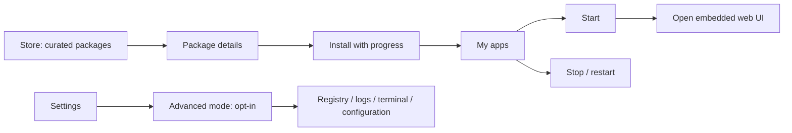

# Proposed Android UI flow

Design proposal prepared before implementation.
The product screens and data-management child screen are now implemented locally;
visual, accessibility and device acceptance remain pending the integrated phase.
The interactive conversation sketches use illustrative applications, not verified
catalog entries. No placeholder example may become an installable production item.

## Navigation



Bottom navigation: Store, My apps, Settings. Package details and the embedded web
page are child destinations with a clear Back action. Do not add endpoint pickers
until another endpoint is supported. Do not show a Docker navigation destination.

## Screens and states

| Screen | Main content | Main action | Required non-happy paths |
| --- | --- | --- | --- |
| Store | Curated packages, plain descriptions, verified compatibility only with evidence | Details | Loading, empty catalog, offline cached catalog, update error |
| Details | Publisher, version, license, purpose, screenshots if available, requested access, data size | Install / Start / Open according to actual state | Incompatible, insufficient storage, download failure, corrupt package |
| My apps | Installed applications, running/stopped/error state, persisted data | Start / Open | Empty state, starting, stopping, failure, permission explanation |
| Settings | Storage, about/licenses, opt-in advanced mode | Toggle advanced mode | Destructive data actions require scoped confirmation |

Starting/stopping state must come from the engine; UI actions must not optimistically
claim the process is running. Disable duplicate actions while an operation is in
flight. Installation progress identifies resolving/downloading/verifying without
exposing temporary download URLs. The user-facing app name comes from catalog
metadata; raw registry references are secondary information.

Normal mode shows no terminal, command flags, environment values, port numbers or
volume paths. Advanced mode reveals the full public registry (clearly unverified),
live logs, terminal and explicit configuration. Enabling advanced mode does not
grant guest filesystem or network capabilities.

Web launch resolves the instance's assigned loopback mapping. Never trust a recipe
or guest to choose an arbitrary app WebView origin, and never expose Android APIs
through a JavaScript bridge to guest pages. LAN sharing remains opt-in in Stage 2.

Foreground execution has an ongoing notification with the actual running count
and Stop all. Stopping an application preserves named volumes. Removing images
and deleting persistent data are separate actions.

## Implementation approach

Use Jetpack Compose and Material 3, accessible touch targets, system light/dark
appearance, and localized string resources. Keep FFI calls off the main thread.
Navigation/UI state is thin; lifecycle, persistence, capability checks, progress,
logs and endpoints belong to the Rust engine. The proposed visual style is a
starting point for further design feedback.

## Application data child screen

Shown as a scheme in conversation before the Compose implementation:

```text
Data — application name
  Files / Backup
  folder list and relative navigation
  selected file: Export / Delete
  Import file / New folder
  Save backup / Restore backup
```

The normal application card links to its data without exposing host paths or raw
volume IDs. Multiple data sets use a selector; advanced mode shows volume names.
Mutations and consistent exports/backups require inactive services. Android SAF
grants access only to the selected document; broad storage permission is not used.
Replacement and deletion identify the selected file. Restore explains that it
creates new data and preserves the previous volume. Busy/progress/cancel and
completion/error states come from the actual transfer and metadata operations.

## Advanced output and terminal

Running application cards also include the lifecycle-aware process RSS/CPU
summary shown as a scheme before implementation. See
[driver and resources](driver-and-resources.md#resource-summary).

Shown in conversation before the live log screen and terminal frontend:

```text
Logs — application
  Both / stdout / stderr     Follow live output
  scrollable retained output
  Reload

Terminal — application
  terminal viewport and cursor
  Esc / Tab / interrupt / EOF / arrow keys
  keyboard / text input
```

The log screen is implemented locally. It exposes retention gaps and independent
stream filtering, without presenting plain log text as an interactive terminal.
Native stdin/TTY and generation-scoped controls are implemented alongside a
worker-owned VT100 model and a native Canvas/IME terminal child destination.
TTY and input can be selected in advanced service configuration. The terminal
offers keyboard, special keys, history, manual copy/paste and retained final
display pages; runtime, visual and accessibility acceptance remain pending.


## Group management addition

The conversation schemes were shown before implementing native StackScreens.
My Apps now has Apps/Groups selectors, current membership and paged summaries.
Advanced import uses SAF or a bounded private YAML/JSON draft, explicit preview,
then digest-pinned creation without starting guests. Group details expose actual
member states, separate group start/stop (including cancellation during startup),
individual controls and the existing data/log/terminal/declared-web destinations.
Definition removal confirms preservation of packages and all datasets. See
[stack UI scope and pending acceptance](stack-ui.md). This is local source, not
physical visual, accessibility, provider or runtime acceptance.
