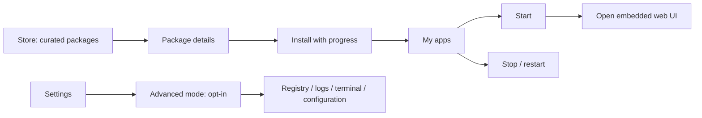

# Proposed Android UI flow

Prepared before implementing the product screens, as requested by George.
The current application still contains only the Stage 0 laboratory screen.
The interactive conversation sketches use illustrative applications, not verified
catalog entries. No placeholder example may become an installable production item.

## Navigation

Bottom navigation: Store, My apps, Settings. Package details and the embedded web
page are child destinations with a clear Back action. Do not add endpoint pickers
until another endpoint is supported. Do not show a Docker navigation destination.

## Screens and states

| Screen | Main content | Main action | Required non-happy paths |
| --- | --- | --- | --- |
| Store | Curated packages, plain descriptions, verified compatibility only with evidence | Details | Loading, empty catalog, offline cached catalog, update error |
| Details | Publisher, version, license, purpose, screenshots if available, requested access, data size | Install / Start / Open according to actual state | Incompatible, insufficient storage, download failure, corrupt package |
| My apps | Installed applications, running/stopped/error state, persisted data | Start / Open | Empty state, starting, stopping, failure, permission explanation |
| Settings | Storage, about/licenses, opt-in advanced mode | Toggle advanced mode | Destructive data actions require scoped confirmation |

Starting/stopping state must come from the engine; UI actions must not optimistically
claim the process is running. Disable duplicate actions while an operation is in
flight. Installation progress identifies resolving/downloading/verifying without
exposing temporary download URLs. The user-facing app name comes from catalog
metadata; raw registry references are secondary information.

Normal mode shows no terminal, command flags, environment values, port numbers or
volume paths. Advanced mode reveals the full public registry (clearly unverified),
live logs, terminal and explicit configuration. Enabling advanced mode does not
grant guest filesystem or network capabilities.

Web launch resolves the instance's assigned loopback mapping. Never trust a recipe
or guest to choose an arbitrary app WebView origin, and never expose Android APIs
through a JavaScript bridge to guest pages. LAN sharing remains opt-in in Stage 2.

Foreground execution has an ongoing notification with the actual running count
and Stop all. Stopping an application preserves named volumes. Removing images
and deleting persistent data are separate actions.

## Implementation approach

Use Jetpack Compose and Material 3, accessible touch targets, system light/dark
appearance, and localized string resources. Keep FFI calls off the main thread.
Navigation/UI state is thin; lifecycle, persistence, capability checks, progress,
logs and endpoints belong to the Rust engine. The proposed visual style is a
working starting point and can be adjusted from George's feedback.
